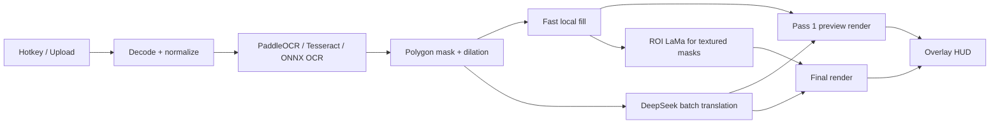

# O-Translator

**Screenshot → OCR → clean plate → context-aware translation → adaptive typesetting.**

O-Translator is a local-first, multi-scenario image translation workbench for manga,
light-novel illustrations, game dialogue boxes, and software UIs. It captures a
desktop region, detects every text line, removes the original lettering with
LaMa (or an OpenCV fallback), translates the whole page as one ordered context
batch through DeepSeek, and redraws the result to match the original boxes,
colors, and reading flow.


## Highlights

- **Real end-to-end pipeline** — not a mock-up: PaddleOCR 3.x, LaMa ONNX,
  DeepSeek chat API, and Pillow typesetting are wired together.
- **Parallel by design** — inpainting runs in a thread pool while the DeepSeek
  request is in flight; both live behind an async job queue.
- **One page, one context** — wrapped OCR lines are reconstructed into paragraph
  blocks before translation; every request sees the whole page (and each chunk
  carries its page text), preserving pronouns, names, and reading flow.
- **Adaptive typesetting** — per-box font fitting, CJK-aware line breaking,
  vertical manga columns anchored at the top, display/bold faces for titles and
  dialogue, white-fill + outlined letters over artwork, dominant text/background
  color extraction, and overflow diagnostics.
- **Two clients** — a zero-build browser UI and a Windows PySide6 desktop assistant
  with an `F2` global hotkey, DPI-aware multi-monitor snipping that highlights the
  window/control under the pointer like Snipaste, a click/drag selection with an
  auto-positioned translate/save/exit toolbar, and fixed-region live monitoring
  with debounce/cooldown. Launching the executable again activates the existing
  instance instead of starting a second tray icon, overlay, or backend. The
  floating result HUD is a true pixel overlay on the captured region; region
  monitoring stays click-through, while a manual area capture is interactive.
  The image itself is the drag handle (no hover title bar); right-click saves or
  closes it, and a soft blue glow marks the outer edge without covering captured
  pixels.
- **Language-aware OCR** — PaddleOCR detection runs at native resolution (fast on
  CPU), recognition crops are upscaled separately, and vertical Japanese columns
  are rotated into reading direction. A second zoomed pass splits cramped
  captions and title pieces, then repairs long-vowel/OCR noise. The per-job
  source language is honored instead of being ignored by a global model choice.
  Languages that load the same models share one initialized backend, `auto` mode
  refines the recognized page in place instead of running a second full OCR pass,
  and the models are warmed in the background at startup.
- **UI chrome stays pixel-perfect** — social headers, handles, timestamps and
  language-neutral counters (`18`, `8.2万`, `1.2K views`) are classified as
  chrome, kept out of the translation request, excluded from the text mask, and
  never redrawn. The original avatar, verified badge, repost/like icon and count
  pixels therefore survive unchanged, even when OCR merged an icon into the
  counter's box.
- **Adaptive inpainting** — every text mask is measured for surrounding-background
  variance. Solid/gradient UI panels, game chat boxes, and speech bubbles skip
  LaMa and use a local Telea/median fill (<15–30 ms); only textured artwork is
  sent to LaMa, cropped to a padded ROI and blended back. One union ROI is used
  by default because each 512×512 FFC inference has a fixed cost.
- **Progressive two-pass UI** — pass 1 renders the translation over the fast
  background as soon as OCR + DeepSeek finish; LaMa continues in the background
  and the desktop HUD swaps to the refined result with a short fade.
- **Hardware acceleration** — shared ONNX Runtime provider policy
  (`CUDA → OpenVINO → DirectML → CPU`), optional FP16/INT8 graphs, and
  OpenVINO/DirectML device options. The provider order is reported by
  `/api/health`.
- **Graceful degradation** — missing LaMa weights are downloaded in the
  background (with proxy / HF-mirror support) and fall back to OpenCV Telea until
  they arrive; missing `DEEPSEEK_API_KEY` keeps OCR text instead of failing the
  job; invalid model JSON is recovered item-by-item.
- **Tested** — pipeline, masking, typesetting, JSON recovery, queue, API,
  artifact endpoints, monitor state machine, DPI mapping, and Qt windows are
  covered by pytest.

## Architecture



```
Screenshot
   │
   ▼
1. OCR ─────────────► polygons, confidence, raw text, orientation
   │
   ▼
2. Mask generation ─► binary mask + elliptical dilation (3–7 px)
   │
   ├───────────────► 3a. Fast local fill (Telea / median, <15–30 ms)
   │                      │
   │                      ├──► pass 1: text over fast background ──► HUD
   │                      │
   │                      └──► ROI LaMa only for textured masks
   │                               │
   │                               ▼
   │                           refined background
   │
   └───────────────► 3b. DeepSeek batch translation (async HTTP)
                          │
                          ▼
                      id → translation
   │
   ▼
4. Typesetting ─────► font auto-fit, wrapping, color, vertical/horizontal
   │
   ▼
5. Result PNG + JSON overlay blocks + artifact URLs + preview.png
```

See [docs/ARCHITECTURE.md](docs/ARCHITECTURE.md) for module-level details,
failure handling, and extension points.

## Quick start

### 1. Requirements

- Python 3.10–3.13 (tested on 3.13 / Windows 11)
- Windows 10/11 for the desktop client; the server and web UI are cross-platform
- A [DeepSeek API key](https://platform.deepseek.com/) for actual translation
  (optional for evaluating the pipeline)

### 2. Install

```powershell
cd O-Translator
python -m venv .venv
.\.venv\Scripts\Activate.ps1

pip install -r requirements.txt
# Desktop client only:
pip install -r requirements-desktop.txt
```

PaddleOCR downloads its detection/recognition models on first use. Chinese,
English, and Japanese all use the lightweight `PP-OCRv5_mobile_*` models for
speed; Japanese columns are detected at native size, recognized from upscaled
crops, and retried on a zoomed cluster when a caption or title was split.
`OTR_PADDLE_PROFILE=quality` opts into the heavier server models at the cost of
CPU time. Model downloads honour `OTR_PROXY` and `OTR_HF_ENDPOINT`.

Optional Tesseract fallback:

```powershell
pip install pytesseract
# Then install the Tesseract OCR binary and make `tesseract` available on PATH.
$env:OTR_OCR_ENGINE = "tesseract"
$env:OTR_TESSERACT_LANG = "chi_sim+eng"
```

### 3. Configure

```powershell
Copy-Item .env.example .env
notepad .env
```

At minimum:

```dotenv
DEEPSEEK_API_KEY=sk-...
OTR_TRANSLATION_PROVIDER=auto
```

Without a key the service starts in **offline mode**: OCR, inpainting, layout,
and export still work, but source text is retained.

If PaddleOCR or LaMa model downloads cannot reach the internet while the browser
can, the browser is probably using an extension-only proxy. Point the backend at
Clash's mixed port explicitly (Clash Verge/Meta usually listens on `7897`):

```dotenv
OTR_PROXY=http://127.0.0.1:7897
# Optional, when huggingface.co is slow/unreachable:
OTR_HF_ENDPOINT=https://hf-mirror.com
```

Start the backend after changing `.env`; `/api/health` reports the LaMa download
progress and the active OCR profile.

### 4. LaMa (bundled in the portable build; auto-downloaded from source)

The Windows portable build ships `models/lama/lama_fp32_sim.onnx` under
`_internal/models/lama/`, so extraction is enough — no first-launch download and
no 25–35 s dynamic-graph optimization. `/api/health` reports
`lama_weights_present: true`, `lama_source: "bundled"`, and `download: null`.

From a source checkout the server downloads the ~198 MB `lama_fp32.onnx`
weights in the background on first start **only when no folded/optimized graph
exists**. Until the download finishes, inpainting uses adaptive local fill /
OpenCV Telea automatically. The same downloader is available from the CLI:

```powershell
python scripts/download_models.py --lama --optimize
python scripts/download_models.py --check
# Behind a browser-only proxy, pass Clash's mixed port explicitly:
python scripts/download_models.py --lama --proxy http://127.0.0.1:7897
```

To disable the background download, set `OTR_LAMA_AUTO_DOWNLOAD=false`. See
[models/README.md](models/README.md).

The Carve export is a dynamic 17k-node graph; ONNX Runtime spends 25–35 s
optimizing it on first load. Fold it once with `onnxsim` (strongly recommended
on CPU):

```powershell
python -m pip install onnxsim
python scripts/optimize_lama.py --verify
```

This writes `models/lama/lama_fp32_sim.onnx` (same output, ~3k nodes); the
inpainter prefers it automatically and loads it in ~2 s. `OTR_LAMA_THREADS` caps
ORT's CPU threads (default auto, max 4), which is faster than letting it grab
every core on a busy desktop.

Precision reduction is available with
`python scripts/optimize_lama.py --precision fp16|int8 --verify`, but FP16/INT8
are **not** CPU defaults: measurement on this project's reference CPU showed
both were slower and numerically unusable for LaMa's FFC/FFT blocks. The
bundled graph is the accurate folded FP32 export. See
[models/README.md](models/README.md) for the measured table and the shared
`CUDA → OpenVINO → DirectML → CPU` provider policy.

### 4b. Optional NVIDIA GPU acceleration

The portable zip stays CPU-only because a CUDA runtime (cuBLAS + cuDNN + cuFFT
+ cuRAND) adds roughly 2 GB. A validated GPU add-on can be built from a source
checkout:

```powershell
powershell -ExecutionPolicy Bypass -File scripts/setup_gpu_runtime.ps1
# writes dist\O-Translator-gpu-runtime-cuda12.zip
```

Extract that archive next to `O-Translator.exe` so the layout is:

```
O-Translator.exe
gpu_runtime\
  onnxruntime\...
```

`core_pipeline/runtime.py` detects `gpu_runtime/` at process startup, puts its
CUDA ONNX Runtime before the bundled CPU runtime, and adds the CUDA DLL
directories to `PATH`. The normal provider policy then selects
`CUDAExecutionProvider`; if the driver/runtime cannot initialize, session
creation retries CPU-only. Set `OTR_DISABLE_GPU=1` to force CPU, or
`OTR_GPU_RUNTIME_DIR` to use a custom add-on location.

Verified on this machine (RTX 5060 Laptop, CUDA 12.8 driver):

| Metric | CPU ORT | CUDA ORT |
|---|---:|---:|
| LaMa 512×512 warm inference | ~2.1 s | **0.21–0.30 s** |
| Manga job 475×705, 3 LaMa regions | ~3.0–3.4 s ROI | **0.26 s ROI** |
| End-to-end manga (OCR + preview + LaMa) | ~4.8 s | **1.83 s** |
| UI 1400×900 (fast path, no LaMa call) | ~1.7 s | same (OCR-bound) |
| Output difference vs CPU | — | max 0.47/255, no pixel >1 |

PaddleOCR remains CPU-bound in this environment: PaddlePaddle does not publish
a Windows GPU wheel for Python 3.13 here, so OCR is not GPU-accelerated. LaMa is
the dominant GPU win for manga/artwork; UI screenshots already skip LaMa.

### 5. Run

```powershell
python -m backend.main
```

Open <http://127.0.0.1:8765>. Drag in a screenshot, choose a scenario, and press
**开始翻译**. API docs live at <http://127.0.0.1:8765/api/docs>.

### 6. Desktop client

```powershell
python -m client.main
# backwards-compatible:
python -m client.desktop
```

- **Manual upload** — file picker, drag/drop, `Ctrl + V`.
- **Area capture** — `F2` (customizable). Move the pointer to highlight the
  window/control underneath; click or `Space` locks that layer, the wheel
  switches between control → window → screen, and dragging selects a custom box.
  A locked selection shows an auto-positioned translate/save/exit toolbar; drag
  inside it to move, right-click to step back, and confirm with the toolbar or
  `Enter`. `Enter` first locks the whole screen. Each monitor gets a DPI-aware
  overlay pane, and the result appears in an always-on-top HUD. Capturing never
  re-opens the main workbench; it stays hidden until you open it from the tray.
  Launching the exe again activates the existing process instead of starting a
  second tray icon, overlay, or backend.
- **Region auto-monitor** — select a fixed game chatbox/manga area once; the
  client polls with `mss`, ignores noise, waits for animations to settle, honors
  a cooldown, and automatically translates when the region meaningfully changes.
- **Tray controls** — pause/resume monitoring, reselect the region, stop, open the
  main window, toggle click-through on the translated HUD, or quit.
- The floating HUD's image is an exact overlay on the captured region (no border
  or letterbox bars inside the captured pixels), so translated lettering lands on
  the original pixels. A manual area capture is interactive by default; region
  monitoring is click-through so the game/application underneath keeps receiving
  the pointer. There is no hover title bar: drag the image itself to detach the
  HUD, right-click for save/close, and use the bottom-right grip to resize. A soft
  blue glow is painted outside the captured pixels so the frameless window stays
  visible without covering the translation.
- The client auto-starts the backend if it is not running (disable with
  `OTR_CLIENT_AUTOSTART_BACKEND=false`).


*Desktop monitoring mode. The translation HUD is a separate always-on-top window.
Configure `DEEPSEEK_API_KEY` to populate translations; without it the source text
is retained.*

See [docs/DESKTOP.md](docs/DESKTOP.md) for capture coordinates, monitor state
machine, HUD behavior, tray actions, and performance notes.

### 7. Windows portable build (no Python required)

```powershell
powershell -ExecutionPolicy Bypass -File scripts/build_windows_exe.ps1
```

The build produces `dist\O-Translator\O-Translator.exe` (PyInstaller, onedir)
and `dist\O-Translator-windows-x64.zip`. Double-click the exe: it starts in the
system tray without opening the main workbench, and launches the bundled FastAPI
backend itself, so end users need neither Python nor a separate server window.
Press `F2` to capture; results appear in the floating HUD. Open the workbench
from the tray (double-click the tray icon or choose **打开主窗口**) or launch the
exe again. The same exe with `--backend` acts as the service, which is how the
UI launches it; `--doctor` prints a self-check for support, and `--show` opens
the main window directly for development.

The folded LaMa graph is bundled under `_internal\models\lama\`; the build script
refuses to package a tree without it and the smoke test asserts that no LaMa
download starts. `data/` and `models/` next to the exe remain writable for job
artifacts and optional model upgrades.

The API key is read from the environment only — never written into the build:

```powershell
[Environment]::SetEnvironmentVariable('DEEPSEEK_API_KEY', 'sk-...', 'User')
```

Frozen builds also fall back to the persisted user variable in
`HKCU\Environment`, because Explorer keeps a stale environment block after
`setx`. `data/` and `models/` are created next to the exe, so keep the folder in
a writable location. See [packaging/README-Windows.txt](packaging/README-Windows.txt)
for the end-user guide.

## Configuration

All settings use the `OTR_` prefix and can live in `.env` or the environment.

| Variable | Default | Description |
|---|---|---|
| `DEEPSEEK_API_KEY` | — | DeepSeek API key (also `OTR_DEEPSEEK_API_KEY`) |
| `OTR_TRANSLATION_PROVIDER` | `auto` | `auto`, `deepseek`, or `echo` |
| `OTR_DEEPSEEK_MODEL` | `deepseek-chat` | DeepSeek-V3 chat model |
| `OTR_TRANSLATION_BATCH_SIZE` | `40` | OCR lines per API request |
| `OTR_TRANSLATION_CONCURRENCY` | `3` | Concurrent chunks per page |
| `OTR_TRANSLATION_FALLBACK_TO_SOURCE` | `true` | Keep OCR text on API failure |
| `OTR_OCR_ENGINE` | `auto` | `auto`, `paddle`, `onnx`, `tesseract`, `none` |
| `OTR_OCR_DEVICE` | `auto` | ONNX OCR provider: `auto`, `cpu`, `cuda`, `openvino`, `dml` |
| `OTR_OCR_PROVIDERS` | — | Explicit ONNX OCR provider order |
| `OTR_PADDLE_LANG` | `ch` | Default Paddle language when source is `auto` (`japan` switches the profile) |
| `OTR_PADDLE_PROFILE` | `auto` | `auto` (language-aware), `fast` (mobile), `quality` (server models) |
| `OTR_PADDLE_AUTO_FALLBACK` | `true` | Retry with the Japanese model when kana/vertical text is detected |
| `OTR_PADDLE_DET_LIMIT_SIDE_LEN` | `1280` | Paddle detection long-side cap |
| `OTR_OCR_MIN_CONFIDENCE` | `0.5` | Drop low-confidence lines |
| `OTR_INPAINT_ENGINE` | `auto` | `auto`, `lama`, `opencv` |
| `OTR_LAMA_MODEL_PATH` | `models/lama/lama_fp32.onnx` | Base ONNX weights; `_sim`/`_fp16`/`_int8` siblings are discovered automatically |
| `OTR_LAMA_PRECISION` | `auto` | `auto`, `fp32`, `fp16`, `int8` |
| `OTR_LAMA_AUTO_DOWNLOAD` | `true` | Download only when no local/bundled graph exists |
| `OTR_LAMA_DEVICE` | `auto` | `auto`, `cpu`, `cuda`, `openvino`, `dml` |
| `OTR_LAMA_PROVIDERS` | — | Explicit ORT provider order; empty = device policy |
| `OTR_LAMA_OPENVINO_DEVICE` | `CPU` | OpenVINO `device_type` (`CPU`, `GPU`, `AUTO`) |
| `OTR_LAMA_DML_DEVICE_ID` | `0` | DirectML adapter id |
| `OTR_LAMA_THREADS` | `0` | ORT CPU threads; `0` = auto, capped at 4 |
| `OTR_INPAINT_MAX_SIDE` | `1024` | Resolution cap for dynamic-shape exports (the fixed 512×512 LaMa export ignores it) |
| `OTR_INPAINT_FAST_STDDEV` | `24` | Skip LaMa below this surrounding-background stddev |
| `OTR_INPAINT_SOLID_STDDEV` | `3` | Use plain median fill below this stddev |
| `OTR_INPAINT_ROI_PADDING` | `16` | Padding around LaMa ROI patches |
| `OTR_INPAINT_MAX_ROI_PATCHES` | `1` | Patch budget; one union ROI is fastest on CPU |
| `OTR_INPAINT_BLEND` | `alpha` | `alpha` or `seamless` (Poisson) blending |
| `OTR_PROGRESSIVE_PREVIEW` | `true` | Emit pass-1 preview while LaMa finishes |
| `OTR_PROXY` | — | Proxy for model downloads, e.g. `http://127.0.0.1:7897` |
| `OTR_HF_ENDPOINT` | — | Hugging Face mirror, e.g. `https://hf-mirror.com` |
| `OTR_DILATE_PX` | `7` | Mask dilation kernel diameter (3–7) |
| `OTR_QUEUE_WORKERS` | `2` | Concurrent pipeline jobs |
| `OTR_MAX_UPLOAD_MB` | `20` | Upload limit |
| `OTR_MAX_IMAGE_SIDE` | `2400` | Downscale cap before OCR |
| `OTR_FONT_PATH` | auto | Explicit CJK TTF/OTF/TTC |
| `OTR_API_URL` | `http://127.0.0.1:8765` | Desktop client API base |
| `OTR_HOTKEY` | `f2` | Desktop global hotkey (single key allowed) |

## API in 30 seconds

```powershell
# Submit a job
curl.exe -X POST http://127.0.0.1:8765/api/jobs `
  -F "file=@examples/demo_game_ui.png" `
  -F "source_lang=zh" `
  -F "target_lang=en" `
  -F "mode=game" `
  -F "reading_order=ltr"

# Poll it
curl.exe http://127.0.0.1:8765/api/jobs/<job-id>

# Download the rendered PNG
curl.exe -OJ http://127.0.0.1:8765/api/jobs/<job-id>/download
```

The job response contains `result.regions` (source + translation + bbox),
`result.blocks` (font size, lines, colors, layout, overflow), artifact URLs,
engine names, timings, and warnings. While a job is still running it also
exposes `preview` (`preview.png`, pass-1 text over the fast background) so the
HUD can render before LaMa finishes. See [docs/API.md](docs/API.md).

## Project layout

```
O-Translator/
├── backend/
│   ├── api.py            FastAPI routes, SSE, validation, artifact serving
│   ├── artifacts.py      atomic PNG/JSON persistence and result shaping
│   ├── config.py         pydantic-settings configuration
│   ├── jobs.py           async queue, worker pool, job state machine
│   └── main.py           app factory, engine wiring, lifespan, entry point
├── core_pipeline/
│   ├── pipeline.py       end-to-end orchestration + concurrent stages
│   ├── ocr.py            PaddleOCR modules, language routing, reading order
│   ├── mask.py           polygon rasterization + elliptical dilation
│   ├── inpainting.py     adaptive fast fill + ROI LaMa + OpenCV fallback
│   ├── runtime.py        shared ORT provider policy (CUDA/OpenVINO/DML/CPU)
│   ├── model_store.py    background model download (proxy / HF mirror)
│   ├── translation.py    DeepSeek batching, retries, JSON recovery
│   ├── typesetting.py    font fitting, wrapping, colors, vertical layout
│   ├── image_utils.py    safe decode/resize/encode
│   ├── types.py          domain models and options
│   └── errors.py         structured error taxonomy
├── client/
│   ├── main.py           three-mode desktop window + tray + job orchestration
│   ├── desktop.py        backward-compatible launcher
│   ├── ui/
│   │   ├── overlay_snipper.py   per-screen DPI-aware snipping panes
│   │   ├── floating_window.py   always-on-top/resizable/click-through HUD
│   │   ├── widgets.py           canvas and layout helpers
│   │   └── styles.py / *.qss    desktop theme
│   ├── services/
│   │   ├── screen_capture.py    QScreen ↔ mss physical mapping, capture
│   │   ├── region_monitor.py    QThread diff/debounce/cooldown monitor
│   │   ├── hotkey.py            Windows global hotkey
│   │   └── api_client.py        job API, backend autostart, workers
│   └── web/              zero-build browser workbench
├── models/               LaMa weights (not committed), fonts, docs
├── examples/             generated demo screenshots
├── scripts/              model download, demo generation, launch helpers
├── tests/                pytest suite
└── docs/                 architecture, API, desktop, performance, screenshots
```

## How the hard parts work

**OCR reading order.** Polygons are grouped into rows for horizontal text or
columns for vertical text. Manga mode switches to right-to-left columns; game,
novel, and UI modes default to left-to-right. Per-line direction is inferred
from the OCR box aspect ratio and CJK content.

**Translation context.** The model receives the whole page (or a 40-line chunk)
in reading order with ids, box dimensions, orientation, and a character budget.
The prompt forbids merging/splitting ids and requests JSON only. Missing ids
fall back to source text; extra ids are ignored; malformed JSON is retried.

**Inpainting.** The mask is rasterized from OCR polygons and dilated with an
elliptical kernel. LaMa runs at a capped resolution with dimensions rounded to a
multiple of 8, then resizes back and composites only through a feathered mask so
pixels outside the text are untouched.

**Window/control picking.** UIA `ElementFromPoint` cannot be used while the
always-on-top overlay covers the screen, because it reports the overlay. The
desktop instead walks the Win32 z-order with `EnumWindows`, skips HWNDs owned by
the client, and renders the smallest child rectangle containing the cursor. UI
Automation then enriches that chain from `ElementFromHandle` (using the Chromium
renderer HWND for browser/Electron content), descending only the Control View
branch under the pointer. The Win32 result is emitted first for an instant
highlight; both passes run on a 60 Hz-coalesced daemon thread with a stale-result
serial, and no `comtypes`/`pywin32` dependency is needed. See
[docs/DESKTOP.md](docs/DESKTOP.md#automatic-windowcontrol-picking).

**Typesetting.** For each box, the renderer drops the font size until the
wrapped text fits. CJK text is broken at character boundaries with basic
kinsoku rules; Latin text is broken at word boundaries. Vertical Japanese/Chinese
columns are supported for tall boxes. Text and background colors are sampled
from the original crop and checked for WCAG contrast.

## Performance

Steady-state latency is dominated by OCR and LaMa inpainting; typesetting is
12–66 ms per page. The models are warmed in the background at startup, `auto`
language detection refines an already-recognized page instead of running a
second full OCR pass, and the renderer converts the page pixels once and uses an
additive-advance wrapper for CJK. Identical screenshots are cached, so
re-submitting one skips OCR entirely.

The bundled LaMa export is a fixed 512×512, 17k-node FFT graph. Its cold load
spends 25–35 s in ONNX Runtime graph optimization; `scripts/optimize_lama.py`
folds it to ~3k nodes and cuts that to 1.6–2.3 s with identical output. ORT is
also capped at four inference threads (`OTR_LAMA_THREADS`), which is ~1.8×
faster than letting it grab every logical core on a busy hybrid CPU.

On a 10-core laptop CPU a 900×1280 manga page costs roughly 0.8–1.6 s OCR +
2.6 s LaMa (idle) or ~7 s LaMa (busy desktop) + 0.02–0.07 s typesetting after
warm-up. The first job before the warm-up finishes still pays model
initialization.

See [docs/PERFORMANCE.md](docs/PERFORMANCE.md) for measured before/after tables,
including the LaMa graph analysis, the approaches that were measured and
rejected, and how to reproduce the numbers with `scripts/benchmark_pipeline.py`.

## Quality checks

```powershell
python -m pytest -q
python -m ruff check backend core_pipeline client tests scripts
```

Generate fresh demo assets:

```powershell
python scripts/make_demo_assets.py
```

## Known limitations

- LaMa weights are not bundled; the server downloads them on first start. The
  bundled export is a fixed 512×512, 17k-node graph: CPU inference costs ~2.6 s
  even when idle, and the first session creation spends 25–35 s in ONNX Runtime
  graph optimization. Running `scripts/optimize_lama.py` once drops the load
  time to ~2 s; the server also warms LaMa in the background, but a job that
  arrives before that finishes still pays the one-off cost. OpenCV is noticeably
  weaker on complex artwork.
- Vertical text is rendered with upright glyphs; rotated punctuation
  (`、` `。` `ー`) is not yet rotated for print-quality manga.
- OCR is selected per job from `source_lang` / `mode`. `auto` mode recognizes the
  page once and refines it in place when it sees kana or vertical text; only
  languages whose models actually differ (for example Korean) trigger a full
  second OCR pass. The zoomed refinement still costs a few crop detections on
  suspicious lines.
- Rotated/skewed text boxes are redrawn axis-aligned within their bounding box.
- Automatic window/control picking is Windows-only; other platforms keep manual
  drag selection. Even on Windows, canvas/self-rendered pages may expose only a
  document or window through UI Automation, and elevated/UIPI windows may deny
  UIA entirely. In both cases the Win32 window/client/child rectangles remain
  available, so the overlay still selects the window rather than failing.
- Region monitoring compares one fixed rectangle. If the main window or floating
  HUD overlaps it, that area is excluded from the diff; changes are skipped while
  a translation job is in flight.
- The multi-monitor geometry math is unit-tested for negative origins and
  fractional DPI. Live capture was verified on the available single-monitor host;
  run the desktop on your exact monitor layout to confirm OS-specific scaling.
- The server has no authentication and binds to `127.0.0.1` by default. Do not
  expose it directly to the internet; put auth and TLS in front if needed.
- API keys stay server-side and are never returned by `/api/health`.

## Credits

- [PaddleOCR](https://github.com/PaddlePaddle/PaddleOCR) and PaddlePaddle
- [LaMa: Resolution-robust Large Mask Inpainting](https://github.com/advimman/lama)
- [Carve/LaMa-ONNX](https://huggingface.co/Carve/LaMa-ONNX) model export
- [DeepSeek API](https://platform.deepseek.com/)
- [Pillow](https://python-pillow.org/) and [OpenCV](https://opencv.org/)

## License

MIT for this repository's source code. Model weights, fonts, and third-party
services retain their own licenses.